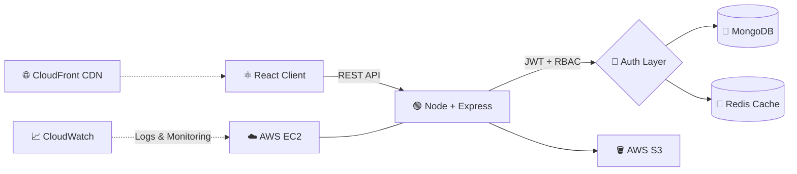

<!-- ============ ANIMATED HEADER ============ -->
<p align="center">
  
</p>

<p align="center">
  <a href="https://git.io/typing-svg">
    
  </a>
</p>

<p align="center">
  <a href="https://www.linkedin.com/in/ayush-srivastava-235a3a2a2"></a>
  <a href="https://leetcode.com/u/Ayush1528"></a>
  <a href="mailto:ayushsri1528@gmail.com"></a>
  <a href="https://github.com/ayush15-28"></a>
</p>

<p align="center">
  
  
  
</p>

---

## 👨‍💻 &nbsp;About Me

```js
const ayush = {
  name: "Ayush Srivastava",
  role: "Backend Developer | Full Stack (MERN)",
  education: "B.Tech CSE @ KIET Group of Institutions (2023 - 2027) | CGPA 8.0",
  currentlyAt: "Mystic Bug Studios (Alumni Interaction Website)",
  strongAt: ["REST APIs", "Redis Caching", "JWT + RBAC", "AWS Deployment", "DSA"],
  achievements: [
    "🏆 Runner-up - HackIndia 2026 (NIT Delhi)",
    "🥉 3rd Rank - KIET InnoTech 2025",
    "💻 1000+ DSA problems (550+ on LeetCode)",
    "⚡ CodeChef global rank < 500",
    "☁️ AWS Certified Cloud Practitioner"
  ],
  currentlyLearning: ["System Design", "Microservices", "Advanced Redis patterns"],
  funFact: "I turn slow APIs into fast ones 🚀"
};
```

---

## 🛠️ &nbsp;Tech Arsenal

<table align="center">
  <tr>
    <td align="center"><b>Languages</b></td>
    <td></td>
  </tr>
  <tr>
    <td align="center"><b>Frontend</b></td>
    <td></td>
  </tr>
  <tr>
    <td align="center"><b>Backend</b></td>
    <td></td>
  </tr>
  <tr>
    <td align="center"><b>Databases</b></td>
    <td></td>
  </tr>
  <tr>
    <td align="center"><b>Cloud &amp; Deploy</b></td>
    <td></td>
  </tr>
  <tr>
    <td align="center"><b>Tools</b></td>
    <td></td>
  </tr>
</table>

<p align="center">
  <b>Core CS:</b> DSA • OOP • DBMS • Operating Systems • Computer Networks
</p>

---

## 🏗️ &nbsp;How I Build Backends



---

## 🚀 &nbsp;Featured Projects

### 🎮 Gamified Education Platform


- 📚 Study plans, quizzes, progress tracking, streaks and rewards
- 🔐 JWT auth, bcrypt hashing and role-based authorization
- ⚡ Google APIs + YouTube content with Redis caching → **30% fewer repeated API calls**
- 💳 Razorpay payments with server-side signature verification
- ☁️ Hosted on AWS EC2, files on S3, monitored with CloudWatch

### 🔍 Google Custom Search Web App


- ⌨️ Debounced input + lazy rendering to cut unnecessary requests
- 🧠 Redis caching, pagination and rate limiting → **30% fewer upstream calls**
- 🧭 Client-side routing for All / Images / News / Videos without page reloads
- 🌍 CloudFront CDN delivery → **25% lower asset-loading latency**

### 🎓 Alumni Interaction Website (Mystic Bug Studios)
- 🛠️ REST APIs with middleware validation, centralized error handling, Jest + Supertest tests
- 📉 MongoDB index tuning + Redis caching → **20-30% lower API latency**, **30% fewer DB queries**
- 🔒 JWT, bcrypt and RBAC on alumni and admin endpoints
- ☁️ AWS EC2 deployment, S3 storage, CloudWatch monitoring

---

## 📊 &nbsp;GitHub Analytics

<p align="center">
  
  
</p>

<p align="center">
  
</p>

<p align="center">
  
</p>

<p align="center">
  
</p>

---

## 🧩 &nbsp;Competitive Programming

<p align="center">
  
</p>

<p align="center">
  
  
  
</p>

---

## 🐍 &nbsp;Contribution Snake

<p align="center">
  
</p>

---

## 🏅 &nbsp;Achievements &amp; Certifications

| 🏆 Achievements | 📜 Certifications |
|---|---|
| Runner-up, HackIndia 2026 (NIT Delhi) | AWS Certified Cloud Practitioner |
| 3rd Rank, KIET InnoTech 2025 | Operating Systems - Springboard |
| CodeChef global rank under 500 | DBMS - Springboard |
| 1000+ DSA problems solved | OOP - Springboard |
| 550+ LeetCode problems | Networking Essentials - Cisco |
| | Accelerated CS Fundamentals - Coursera |

---

## 🤝 &nbsp;Let's Connect

<p align="center">
  <a href="https://www.linkedin.com/in/ayush-srivastava-235a3a2a2"></a>
  <a href="mailto:ayushsri1528@gmail.com"></a>
</p>

<p align="center">
  
</p>

<p align="center">
  
</p>


